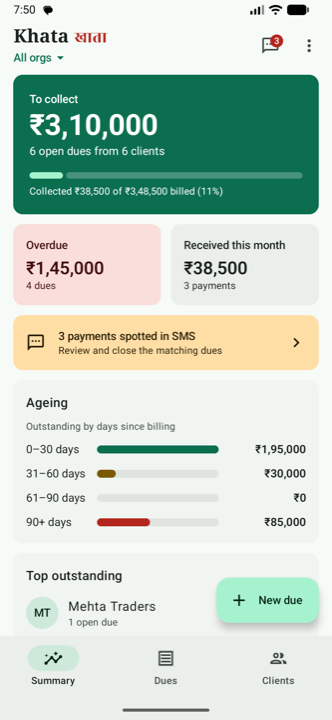
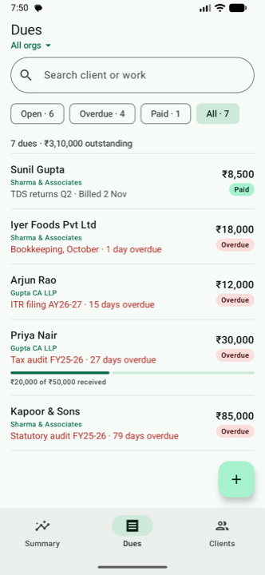
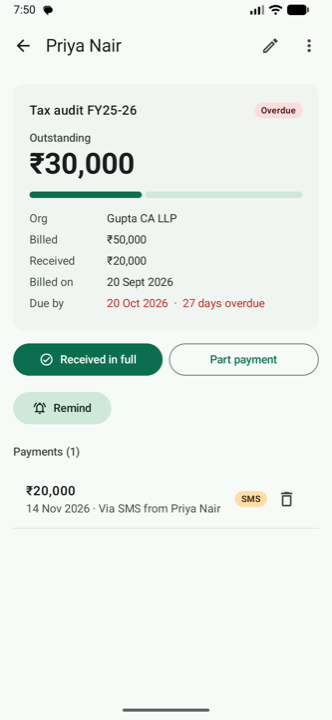
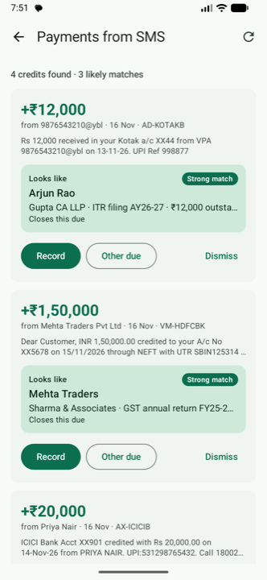

<p align="center">
  
</p>

<h1 align="center">Khata खाता</h1>

**A pocket ledger for professionals who get paid by clients.** Record what each client owes,
tick off payments as they come in (in full or in parts), and see at a glance who still owes
what. Built for chartered accountants, consultants, lawyers, designers: anyone who bills.

Khata runs entirely on your phone. No account, no server, no tracking.

<p>
  
  
  
  
</p>

## Features

- **Dues and payments**: record a due (client, work, amount, billed date, due date) and mark it
  received in full with one tap, or record part payments as they arrive.
- **Summary**: amount to collect, overdue amount, money received this month, ageing buckets
  (0–30 / 31–60 / 61–90 / 90+ days) and your top outstanding clients.
- **Payments from SMS**: reads bank and UPI credit alerts on the device and suggests which due each
  one settles, matching on payer name, the client's phone number inside a UPI ID, and amount.
  Debits, OTPs, collect requests and bills are ignored. Nothing leaves the phone.
- **Multiple organisations**: if you bill on behalf of more than one firm, tag each due with its
  org and switch between them. Totals, lists, reminders and exports follow the selected org.
- **Reminders**: send a polite payment reminder over WhatsApp, SMS or any app.
- **Contacts**: pick a client straight from your phone's contacts (no contacts permission needed).
- **Export**: share or save the whole ledger as a TSV file that opens directly in Excel or Sheets.
- Indian number formatting (₹1,50,000), light and dark themes.

## Install

Khata isn't on the Play Store: Google Play only allows SMS access for default SMS apps, and
reading credit alerts is a core feature here. Build it yourself (below), or install an APK from a
release and allow "install unknown apps" for the app you opened it from.

## Build

Requirements: JDK 17+ and the Android SDK (compile SDK 37; the build downloads it if missing). Targets Android 16 (API 36), runs on Android 8.0+. Android Studio works out of the box.

```sh
./gradlew assembleDebug        # app/build/outputs/apk/debug/app-debug.apk
./gradlew installDebug         # install on a connected device or emulator
./gradlew testDebugUnitTest    # unit tests (SMS parsing, matching, export)
./gradlew lintDebug
```

### Release signing

Release builds use the key described in `keystore.properties` at the repo root (git-ignored).
Without it they fall back to your local debug key, which is fine for trying things out but means
you can't publish updates over that install later.

```sh
keytool -genkeypair -v -keystore keystore/khata-release.jks -storetype PKCS12 \
  -alias khata -keyalg RSA -keysize 4096 -validity 10000 -dname "CN=Khata"
```

```properties
# keystore.properties
storeFile=keystore/khata-release.jks
storePassword=…
keyAlias=khata
keyPassword=…
```

Then `./gradlew assembleRelease`. Keep the keystore and its password backed up: Android only
installs updates signed with the same key.

### Versioning

Versions come from the UTC time of the latest git commit:
`versionName` is `yymmdd.HHMM` (for example `261116.1930`) and `versionCode` is minutes since
2020-01-01, so every commit builds a newer, installable version.

## How it's built

Kotlin, Jetpack Compose (Material 3), Room, Navigation Compose. A single-activity app with one
shared ViewModel.

```
app/src/main/java/dev/midplane/khata/
├── data/   Room entities, DAO, database + migrations, summary maths, TSV export
├── sms/    reading the SMS inbox, parsing credit alerts, matching them to dues
└── ui/     theme, shared components, ViewModel, and one file per screen in ui/screens/
```

Room schemas are exported to `app/schemas/` and committed; any change to the entities needs a
new database version and a migration in `KhataDatabase`.

## Privacy

- Data lives in a local database on the device. There is no network permission.
- `READ_SMS` is requested only when you open "Payments from SMS"; messages are parsed on-device
  and never stored, except a short key for ones you've recorded or dismissed so they aren't
  suggested again.
- Contacts are read through the system picker, which shares only the single contact you choose.

Full details: [Privacy policy](PRIVACY.md).

## Contributing

Issues and pull requests are welcome. Please keep changes focused, add a unit test for parsing or
matching changes (`app/src/test`), and make sure `./gradlew testDebugUnitTest lintDebug` passes.
Sample bank SMS formats that Khata misreads are especially useful. Please anonymise them first.

## License

Khata is free software: you can redistribute it and/or modify it under the terms of the
[GNU General Public License v3.0](LICENSE) or (at your option) any later version.

The Rozha One typeface (used for खाता and the ₹ in the icon) is © Indian Type Foundry,
licensed under the SIL Open Font License 1.1. See [`third_party/rozha-one`](third_party/rozha-one).
